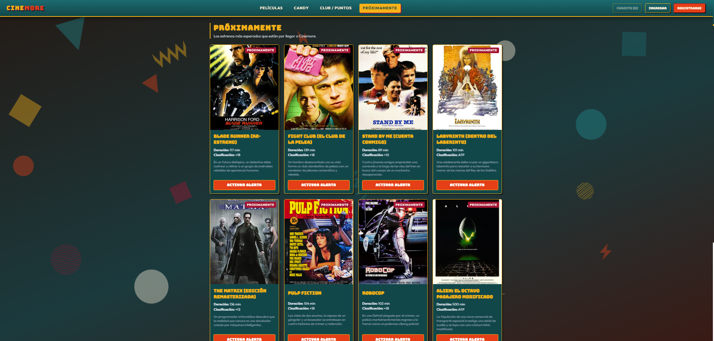
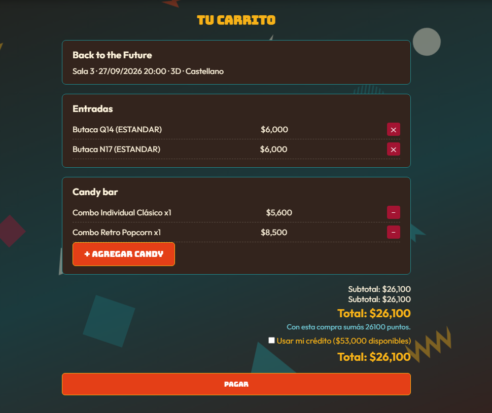
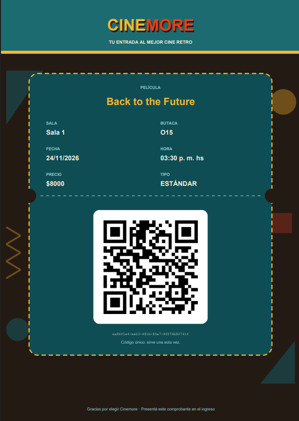

# CINEMORE — Sistema de Gestión y Venta de Entradas

Aplicación web desarrollada en **Angular 22** conectada en tiempo real a **Supabase (PostgreSQL)** para la reserva, gestión y venta de entradas de cine y productos de candy bar. Incluye panel de administración con roles configurables, validación de entradas para el personal, programa de puntos, notificaciones en tiempo real, lista de espera y es **instalable como PWA**.

- **Demo:** `https://tp1-programacion-iv-more-lucas.vercel.app/`
- **Autor:** Lucas More Martín — Laboratorio de Programación IV, UTN

---

## Estado del Proyecto: Primera parte y Recuperatorio completos

| Bloque | Estado |
| :--- | :--- |
| Cartelera, géneros, Top 3, buscador, próximamente con alerta | Hecho |
| Salas y butacas en tiempo real, compra (también anónima), ticket con QR y PDF | Hecho |
| Candy bar, combos y preventa | Hecho |
| Cupones, restricción de edad, puntos, canjes, perfil, crédito y cancelación de compra | Hecho |
| Reseñas con estrellas y "Mis películas" | Hecho |
| Empleado: validación de entradas, candy y canjes | Hecho |
| Admin: películas, funciones (sala automática), productos, cupones, recompensas | Hecho |
| Reportes por día, exportación a PDF y Excel (CSV), gráficos y log de actividad | Hecho |
| Recuperatorio: notificaciones, propuestas, cancelación de función, roles configurables, lista de espera | Hecho |
| PWA instalable + diseño adaptado a celular | Hecho |

### Capturas de la Aplicación

#### 1. Cartelera Principal
Franja **Top 3 más vendidas** arriba, buscador, filtro por género, insignia de preventa y tarjetas con formato retro, géneros, clasificación (+13, +18, ATP) y sinopsis limitada:


#### 2. Sección Próximamente (Estrenos Futuros)
Películas con `esta_en_cartelera = FALSE`, ordenadas por fecha de estreno. El usuario puede **activar una alerta** y se le avisa por la campanita cuando se abre la venta:


#### 3. Sala con butacas en tiempo real
Filas A–T con la fila J accesible, butacas VIP con recargo y asientos que se bloquean al instante cuando otra persona los compra:


#### 4. Candy bar, carrito y ticket



#### 5. Panel de administración


---

## Identidad Visual y Paleta de Colores

El diseño visual se construyó con estética **retro-cinema** de alto contraste: fondo en degradé con formas geométricas flotantes, tipografía pixelada para los títulos y colores cálidos para destacar las acciones.

| Elemento / Rol | Color Hex | Muestra | Descripción |
| :--- | :--- | :--- | :--- |
| **Fondo Principal** | `#241a15 → #1b3a3d → #3a1a14` |  | Degradé marrón-petróleo-granate, fijo detrás de todo, con formas animadas. |
| **Barra de Navegación** | `#1b6b70` |  | Verde azulado con borde amarillo inferior. También es el color de tema de la PWA. |
| **Tarjetas** | `#0b1f28` |  | Base petróleo oscuro para inmersión visual. |
| **Bloque Informativo** | `#004d5a` |  | Verde azulado profundo para el cuerpo de las tarjetas. |
| **Títulos y Acentos** | `#f7a827` |  | Amarillo dorado para tipografía retro y destacados. |
| **Botón de Acción (CTA)** | `#e64c23` |  | Naranja rojizo para llamadas a la acción (*Ver Funciones*, *Pagar*, *Registrarse*). |
| **Textos Secundarios** | `#72cbd8` |  | Celeste cian para sinopsis y descripciones breves. |

---

## Arquitectura Técnica y Decisiones

### Estructura del proyecto
```
src/app/
├── components/   pantallas: cartelera, proximamente, funciones, sala, asiento, candy, checkout,
│                 ticket, perfil, mis-peliculas, proponer-pelicula, club-puntos, campanita,
│                 login, registro, empleado/validador y admin/... (películas, funciones,
│                 productos, cupones, recompensas, reportes, gráficos, log, propuestas, roles)
├── services/     acceso a datos: cada servicio habla con Supabase
├── models/       interfaces TypeScript (Pelicula, Butaca, Carrito, Resena...)
├── guards/       authGuard, roleGuard, personalGuard, permisoGuard, formGuard
├── directivas/   appAdmin, appPersonal, appPermiso (estructurales) y appHoverZoom (de atributo)
├── pipes/        duracion, filtro (buscador)
└── utils/        preventa (regla de fechas de la preventa)
```

### Componentes Standalone (Angular)
Se optó por la arquitectura moderna de **Standalone Components**: cada componente declara únicamente las dependencias que consume en su arreglo `imports: [...]`. Las pantallas se cargan con **rutas de carga diferida** (`loadComponent`), por lo que cada una se descarga recién cuando se visita.

### Signals y formularios
El estado de las pantallas (listas, mensajes, carrito, sesión) se maneja con **signals**. Los formularios de login, registro, película y producto usan **Signal Forms** con validaciones declarativas (`required`, `email`, `min`). En pantallas simples del admin usé variables de plantilla (`#campo`) y eventos, porque no necesitaban un formulario completo.

### Padre e hijo (Input / Output)
La sala es el componente padre y cada butaca es un componente hijo (`Asiento`). El padre le pasa la butaca, si está ocupada y si está elegida con `input()`, y el hijo avisa cuando le hacen click con `output()`. Lo mismo para las reseñas: la pantalla de funciones le pasa el id de la película con `input.required`.

### Capa de Servicios y Desacoplamiento
La lógica de negocio y las consultas a la base no se resuelven dentro del HTML ni en los componentes, sino en servicios (`@Service()`). Cada servicio crea su cliente de Supabase y expone métodos con un solo propósito:
* **`Peliculas`, `Funciones`, `Butacas`, `Candys`:** consultas del catálogo y ABM del administrador.
* **`Auth`:** sesión, registro, perfil y rol del usuario (signals `emailUsuario` y `rolUsuario`).
* **`Carrito`:** estado compartido entre Sala, Candy, Checkout y la barra de navegación.
* **`Compras`, `Cupones`, `Recompensas`, `Resenas`, `Reportes`, `Validaciones`, `Comprobantes`:** compra, descuentos, puntos, reseñas, reportes, validación del personal y generación de QR/PDF.
* **`Notificaciones`, `Propuestas`, `Permisos`, `Espera`, `Alertas`, `Log`:** servicios de los agregados del recuperatorio y del log de actividad.
* **Separación de responsabilidades:** los componentes solo reciben datos y manejan la interacción; la persistencia y las reglas quedan aisladas en el servicio y en la base.

### Control de Flujo Nativo
En los templates se utiliza la sintaxis de control de flujo de Angular (`@if`, `@else`, `@for ... track`, `@empty`).

### Guards, directivas y pipes
* **Guards (funciones):** `authGuard` (hay sesión), `roleGuard` (solo admin, con `canMatch`), `personalGuard` (admin o empleado), `permisoGuard` (permiso sobre una sección del panel) y `formGuard` (avisa al salir de un registro incompleto).
* **Directivas:** `*appAdmin`, `*appPersonal` y `*appPermiso` muestran u ocultan elementos según el rol o el permiso real; `appHoverZoom` agrega un efecto de zoom a las tarjetas.
* **Pipes:** `duracion` (minutos a "2 h 7 min") y `filtro` (buscador por título), además de `currency` y `date` de Angular.

### Tiempo real (Supabase Realtime)
Se usa en **dos lugares**:
1. **Sala:** al comprarse (o liberarse) un asiento, todos los que miran esa función lo ven al instante. Aun así, quien garantiza que no haya doble venta es la **restricción única `(funcion_id, butaca_id)`** de la base.
2. **Notificaciones:** la campanita se actualiza apenas la base inserta una notificación para el usuario.

### PWA
Se instaló con `ng add @angular/pwa`: el **manifest** define nombre, colores e íconos, y el **service worker** guarda la aplicación en caché. Solo se activa en la compilación de producción.

---

## Modelo de Base de Datos (Supabase / PostgreSQL)

| Tabla | Descripción |
| :--- | :--- |
| **`usuarios`** | Perfil del cliente: rol (`admin`, `empleado`, `cliente`), `rol_id` (rol configurable), puntos, crédito y datos personales. |
| **`roles`** | Roles creados por el admin, con su lista de secciones permitidas. |
| **`peliculas`** | Catálogo con duración, clasificación (+13, +18, ATP), cartelera, estreno, descuento de preventa y `ventas_totales`. |
| **`generos`** y **`peliculas_generos`** | Géneros y tabla intermedia (relación muchos a muchos). |
| **`salas`** y **`butacas`** | Salas y matriz de asientos tipificados (`ESTANDAR`, `ACCESIBLE`, `VIP`). |
| **`funciones`** | Horarios por sala y película, con formato (2D/3D/4D/5D), idioma, precio base y `cancelada`. |
| **`compras_entradas`** y **`entradas`** | Compras y tickets emitidos con código QR único. |
| **`productos_candy`** y **`compras_candy`** | Catálogo (incluye combos) y detalle de lo comprado. |
| **`cupones`** | Descuentos configurables (primera compra, mayores de 50). |
| **`recompensas`** y **`canjes`** | Catálogo de canje por puntos e historial de canjes. |
| **`resenas`** | Calificaciones de 1 a 5 estrellas con comentario. |
| **`notificaciones`** | Avisos por usuario (leída o no), con tiempo real. |
| **`propuestas_peliculas`** | Propuestas de clientes: pendiente, aceptada o rechazada. |
| **`lista_espera`** | Cola por función con estado y hora de aviso. |
| **`alertas_estreno`** | Alertas que activa un usuario sobre películas de Próximamente. |
| **`log_actividad`** | Registro automático de acciones del personal (altas, cambios, bajas y validaciones de QR). |

### Seguridad con RLS (Row Level Security)
Todas las tablas tienen **Row Level Security** activado. La lectura pública (`FOR SELECT TO anon, authenticated`) permite consultar la cartelera sin cuenta; las escrituras se restringen con las funciones SQL `es_admin()`, `es_personal()` y `tiene_permiso(seccion)` (*security definer*). Como la clave pública del front es visible por diseño, **la seguridad real vive en las policies**, no en el código de Angular.

### Lógica dentro de la base
Para lo que no debe poder manipularse desde el navegador, la lógica corre en PostgreSQL:
* **Triggers:** suman `ventas_totales`, suman y restan puntos, registran el log de actividad (incluida la validación de QR) y manejan la lista de espera.
* **Funciones llamadas con `rpc`:** `canjear_recompensa`, `usar_canje_entrada`, `usar_credito`, `cancelar_compra`, `cancelar_funcion`, `resolver_propuesta`, `asignar_rol`, `anotarse_espera`, `procesar_espera`, `procesar_alertas` y `notificar`. Cada una es una transacción: se hace todo o no se hace nada.
* **Permisos por columna:** el cliente solo puede modificar el estado de su compra o marcar una notificación como leída; nunca montos ni saldos.
* **Índice único parcial** para la regla "una propuesta pendiente a la vez".

---

## Funcionalidades por rol

* **Visitante (sin cuenta):** cartelera con buscador, filtro por género, Top 3 y preventa; funciones y butacas en tiempo real; candy bar y combos; compra anónima; reseñas de cada película.
* **Cliente:** además, cupones automáticos (20 % primera compra y mayores de 50), restricción de edad, puntos y canje, perfil con crédito y compras, cancelación hasta 2 h antes con crédito, reseñas con estrellas, "Mis películas", alertas de Próximamente, proponer películas, lista de espera y notificaciones.
* **Empleado:** validación de entradas, candy y canjes en `/empleado` (cada código se puede usar una sola vez).
* **Administrador:** ABM de películas (con géneros y preventa), funciones (con **asignación automática de sala** y margen de 30 min), productos y combos, cupones y recompensas; reportes con exportación a PDF/CSV, gráficos, log de actividad, propuestas, cancelación de funciones y roles configurables.
* **Roles personalizados:** acceso solo a las secciones que el admin habilitó.

### Reglas de negocio 
* Salas de 20 filas (A–T) con distribución 4-20-4; la fila J es una fila **accesible** (2-10-2); filas R, S y T son **VIP** con precio mayor.
* Las películas +13 y +18 no pueden ser compradas por menores, y todas sus entradas aclaran que **debe asistir un adulto**.
* **Preventa** desde 7 días antes del estreno con descuento por película; después el precio vuelve al normal.
* **Cancelación de compra** hasta 2 h antes: no se devuelve dinero, se acredita **crédito**.
* **Cancelación de función** por el cine: crédito a todos los compradores, butacas liberadas y aviso, todo en una transacción.
* **Lista de espera:** al liberarse un lugar, el primero tiene **15 minutos** para comprarlo; nadie más puede ocuparlo en ese lapso.
* El pago es simulado (no hay pasarela real).

---

## Cómo correrlo

```bash
npm install
ng serve          # http://localhost:4200
npm run build     # compilación de producción (la PWA solo funciona así)
```
Configurar `src/environments/environments.ts` con la URL y la *publishable key* de Supabase.

---

## Limitaciones conocidas

* **El pago es simulado:** no hay pasarela de pago real.
* **Mapa del cine:** no se implementó; el cliente aclaró en su mail que todavía no tenía luz verde.
* Las **notificaciones del navegador** funcionan con la aplicación abierta (no son push con la app cerrada).
* La **ventana de 15 minutos** de la lista de espera y el aviso de las **alertas de Próximamente** se evalúan cuando alguien consulta o intenta comprar. En producción usaría una tarea programada (`pg_cron`).
* El "Excel" se exporta como **CSV**, que Excel abre directamente.
* El empleado valida **escribiendo el código** o con un lector USB; no escanea con cámara.
* Algunas confirmaciones (borrar, cancelar) usan `confirm()` del navegador en vez de un modal propio.
* El service worker de la PWA solo está activo en la versión de producción.

---

## Tecnologías

| Parte | Tecnología |
| :--- | :--- | :--- |
| Front | Angular 22 (standalone, signals, Signal Forms) 
| Base de datos y autenticación | Supabase (PostgreSQL, Auth, Realtime) 
| PWA | `@angular/pwa` | Instalable y con caché |
| QR y PDF | `qrcode` y `jspdf` | Entrada en PDF con QR; también el reporte |
| Deploy | Vercel + GitHub | Publicación automática en cada *push* |