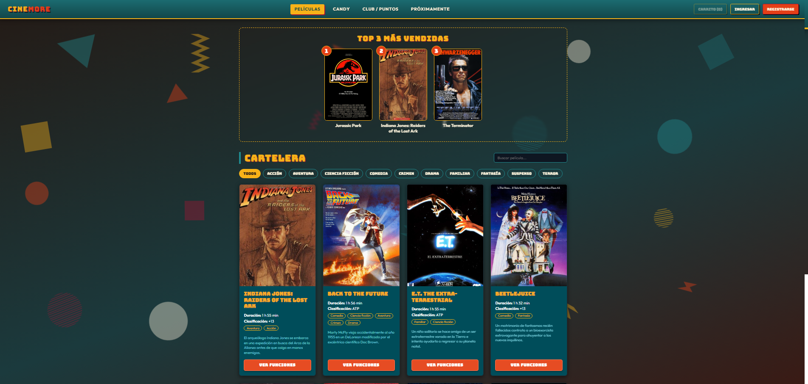
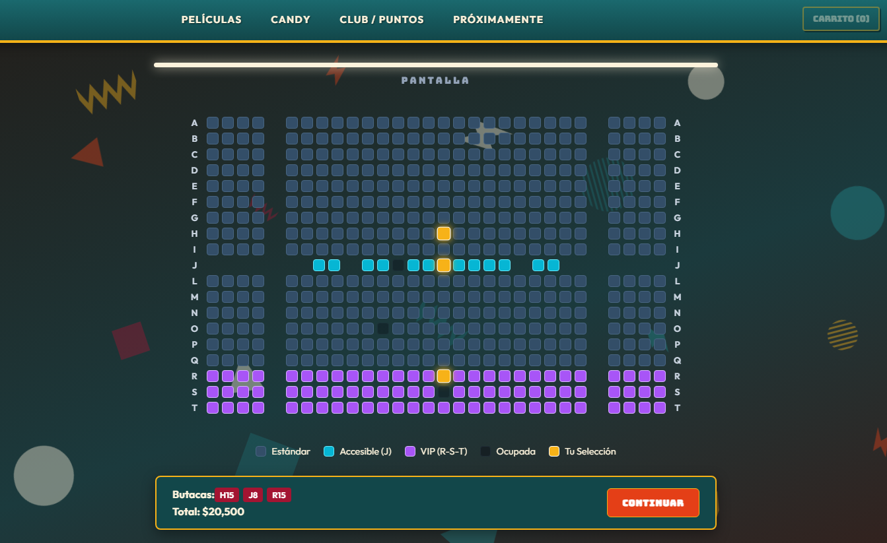
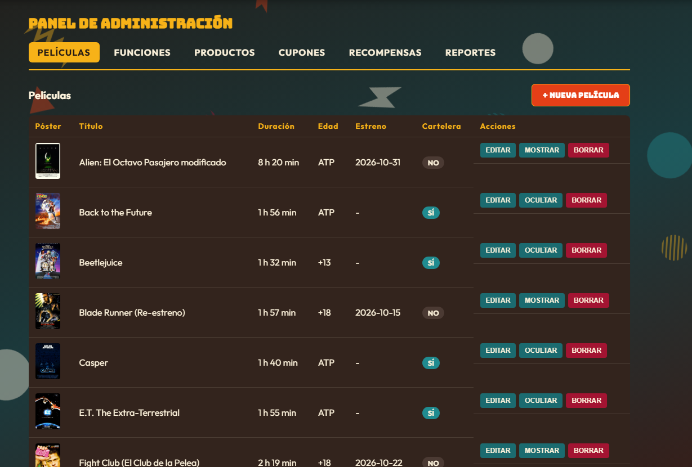

# CINEMORE — Sistema de Gestión y Venta de Entradas
 
Aplicación web desarrollada en **Angular 22** conectada en tiempo real a **Supabase (PostgreSQL)** para la reserva, gestión y venta de entradas de cine y productos de candy bar. Incluye panel de administración, validación de entradas para el personal, programa de puntos y es **instalable como PWA**.
 
- **Demo publicada:** `https://tp1-programacion-iv-more-lucas.vercel.app/`
- **Autor:** Lucas More Martín — Laboratorio de Programación IV, UTN
---
 
## Estado del Proyecto: Primera parte completa + Recuperatorio en curso
 
| Bloque | Estado |
| :--- | :--- |
| Sprint 1: cartelera, próximamente, modelo de datos | Hecho |
| Salas y butacas en tiempo real, compra, ticket con QR y PDF | Hecho |
| Panel de administración (películas, funciones, productos, cupones, canjes, reportes) | Hecho |
| Empleado: validación de entradas y candy | Hecho |
| Puntos, canjes, perfil, cancelación con crédito | Hecho |
| PWA instalable + diseño adaptado a celular | Hecho |
| Pendientes de la primera parte y **agregados del recuperatorio** | Ver [Pendiente](#-pendiente-y-recuperatorio) |
 
### Capturas de la Aplicación
 
#### 1. Cartelera Principal
Franja **Top 3 más vendidas** arriba, buscador, filtro por género y tarjetas con formato retro, géneros, clasificación (+13, +18, ATP) y sinopsis limitada:

 
#### 2. Sección Próximamente (Estrenos Futuros)
Filtrado reactivo desde la base donde `esta_en_cartelera = FALSE`, ordenadas por fecha de estreno:

 
#### 3. Sala con butacas en tiempo real
Filas A–T con la fila J accesible, butacas VIP con recargo y asientos que se bloquean al instante cuando otra persona los compra:

 
#### 4. Carrito, ticket y panel de administración



 
---
 
## Identidad Visual y Paleta de Colores
 
El diseño visual se construyó con estética **retro-cinema** de alto contraste: fondo en degradé con formas geométricas flotantes al estilo Memphis, tipografía pixelada para los títulos y colores cálidos para destacar las acciones.
 
| Elemento / Rol | Color Hex | Muestra | Descripción |
| :--- | :--- | :--- | :--- |
| **Fondo Principal** | `#241a15 → #1b3a3d → #3a1a14` |  | Degradé marrón-petróleo-granate, fijo detrás de todo, con formas animadas. |
| **Barra de Navegación** | `#1b6b70` |  | Verde azulado con borde amarillo inferior. También es el color de tema de la PWA. |
| **Tarjetas** | `#0b1f28` |  | Base petróleo oscuro para inmersión visual. |
| **Bloque Informativo** | `#004d5a` |  | Verde azulado profundo para el cuerpo de las tarjetas. |
| **Títulos y Acentos** | `#f7a827` |  | Amarillo dorado para tipografía retro y destacados. |
| **Botón de Acción (CTA)** | `#e64c23` |  | Naranja rojizo para llamadas a la acción (*Ver Funciones*, *Pagar*, *Registrarse*). |
| **Textos Secundarios** | `#72cbd8` |  | Celeste cian para sinopsis y descripciones breves. |
 
---
 
## Arquitectura Técnica y Decisiones
 
### Estructura del proyecto
```
src/app/
├── components/   pantallas: cartelera, funciones, sala, candy, checkout, ticket, perfil,
│                 club-puntos, login, registro, empleado/validador, admin/...
├── services/     acceso a datos: cada servicio habla con Supabase
├── models/       interfaces TypeScript (Pelicula, Butaca, Carrito, Resena...)
├── guards/       authGuard, roleGuard (admin), personalGuard (admin y empleado), formGuard
├── directivas/   appAdmin y appPersonal (estructurales), appHoverZoom (de atributo)
└── pipes/        duracion, filtro (buscador)
```
 
### Componentes Standalone (Angular)
Se optó por la arquitectura moderna de **Standalone Components**: cada componente declara únicamente las dependencias que consume en su arreglo `imports: [...]`. Las pantallas se cargan con **rutas de carga diferida** (`loadComponent`), por lo que cada una se descarga recién cuando se visita.
 
### Signals y formularios
El estado de las pantallas (listas, mensajes, carrito, sesión) se maneja con **signals**. Los formularios de login, registro y película usan **Signal Forms** con validaciones declarativas (`required`, `email`, `min`).
 
### Capa de Servicios y Desacoplamiento
La lógica de negocio y las consultas a la base de datos no se resuelven dentro del template HTML ni en los componentes, sino en servicios (`@Service()`). Cada servicio crea su cliente de Supabase y expone métodos con un solo propósito:
* **`Peliculas`, `Funciones`, `Butacas`, `Candys`:** consultas del catálogo y ABM del administrador.
* **`Auth`:** sesión, registro, perfil y rol del usuario (signals `emailUsuario` y `rolUsuario`).
* **`Carrito`:** estado compartido entre Sala, Candy, Checkout y la barra de navegación.
* **`Compras`, `Cupones`, `Recompensas`, `Resenas`, `Reportes`, `Validaciones`, `Comprobantes`:** compra, descuentos, puntos, reseñas, reportes, validación del personal y generación de QR/PDF.
* **Separación de responsabilidades:** los componentes solo reciben datos y manejan la interacción; la persistencia y las reglas quedan aisladas en el servicio y en la base.
### Control de Flujo Nativo
En los templates se utiliza la sintaxis de control de flujo de Angular (`@if`, `@else`, `@for ... track`, `@empty`).
### Guards, directivas y pipes
* **Guards (funciones):** `authGuard` (hay sesión), `roleGuard` (solo admin), `personalGuard` (admin o empleado) y `formGuard` (avisa al salir de un registro incompleto).
* **Directivas:** `*appAdmin` y `*appPersonal` muestran u ocultan elementos según el rol real; `appHoverZoom` agrega un efecto de zoom a las tarjetas.
* **Pipes:** `duracion` (minutos a "2 h 7 min") y `filtro` (buscador por título).
### Tiempo real
La sala se suscribe a los cambios de la tabla `entradas` con **Supabase Realtime**: cuando otra persona compra un asiento, se bloquea en pantalla al instante. Aun así, quien garantiza que no haya doble venta es la **restricción única `(funcion_id, butaca_id)`** de la base.
 
### PWA
Se instaló con `ng add @angular/pwa`: el **manifest** define nombre, colores, y el **service worker** guarda la aplicación en caché. Solo se activa en la compilación de producción.
 
---
 
## Modelo de Base de Datos (Supabase / PostgreSQL)
 
El backend y almacenamiento de datos se gestiona directamente en **Supabase** mediante tablas relacionales normalizadas:
 
| Tabla | Descripción |
| :--- | :--- |
| **`usuarios`** | Extensión del perfil del cliente: rol (`admin`, `empleado`, `cliente`), puntos, crédito y datos personales. |
| **`peliculas`** | Catálogo con duración, clasificación (+13, +18, ATP), flags de cartelera/preventa y `ventas_totales`. |
| **`generos`** y **`peliculas_generos`** | Géneros y tabla intermedia (relación muchos a muchos). |
| **`salas`** y **`butacas`** | Capacidad de las salas y matriz de asientos tipificados (`ESTANDAR`, `ACCESIBLE`, `VIP`). |
| **`funciones`** | Horarios de proyección por sala y película, con formato (2D/3D/4D/5D), idioma y precio base. |
| **`compras_entradas`** y **`entradas`** | Operaciones y tickets emitidos con código QR único. |
| **`productos_candy`** y **`compras_candy`** | Catálogo de la candy bar y detalle de lo comprado. |
| **`cupones`** | Descuentos configurables (primera compra, mayores de 50). |
| **`recompensas`** y **`canjes`** | Catálogo de canje por puntos e historial de canjes. |
| **`resenas`** | Calificaciones de 1 a 5 estrellas con comentario. |
 
### Seguridad con RLS (Row Level Security)
Todas las tablas tienen **Row Level Security** activado. La lectura pública (`FOR SELECT TO anon, authenticated`) permite consultar la cartelera sin cuenta; las escrituras se restringen por rol con funciones SQL `es_admin()` y `es_personal()` (*security definer*).
 
### Lógica dentro de la base
Para lo que no debe poder manipularse desde el navegador, la lógica corre en PostgreSQL:
* **Triggers:** suman `ventas_totales` de cada película, suman puntos por compra (1 por peso) y los restan si la compra se cancela.
* **Funciones llamadas con `rpc`:** `canjear_recompensa`, `usar_canje_entrada`, `usar_credito` y `cancelar_compra`. Cada una es una transacción: se hace todo o no se hace nada.
* **Permisos por columna:** el cliente solo puede modificar el estado de su compra, no el total.
---
 
## Funcionalidades por rol
 
* **Visitante (sin cuenta):** cartelera con buscador, filtro por género y Top 3; elegir función y butacas en tiempo real; candy bar; compra anónima; reseñas de cada película.
* **Cliente:** además, cupones automáticos (20 % primera compra y mayores de 50), restricción de edad por película, programa de puntos y canje, perfil con puntos, crédito y compras, cancelación hasta 2 h antes con crédito, y reseñas con estrellas.
* **Empleado:** validación de entradas y retiro de candy en `/empleado` (cada código se puede usar una sola vez).
* **Administrador:** ABM de películas (con géneros), funciones (con **asignación automática de sala** y margen de 30 min), productos de candy, cupones y recompensas; reporte de ventas por día.
### Reglas de negocio destacadas
* Salas de 20 filas (A–T) con distribución 4-20-4; la fila J es una fila **accesible** (2-10-2); filas R, S y T son **VIP** con precio mayor.
* Las películas +13 y +18 no pueden ser compradas por menores, y todas sus entradas aclaran que **debe asistir un adulto**.
* El pago es simulado (no hay pasarela real).
---
 
## Cómo correrlo
 
```bash
npm install
ng serve          # http://localhost:4200
npm run build     # compilación de producción (la PWA solo funciona así)
```
Configurar `src/environments/environments.ts` con la URL y la *publishable key* de Supabase. 
 
---
 
## Pendiente y recuperatorio
 
### Pendiente de la primera parte
- [ ] **Combos** (entrada + pochoclos + bebida) configurables por el admin y destacados en la compra.
- [ ] **Preventa** 7 días antes del estreno, con precio especial por película.
- [ ] **"Mis películas"**: historial visual con pósters, fechas y calificación propia.
- [ ] **Exportar** la facturación a PDF y Excel.
- [ ] **Gráficos** de películas más vistas y producto más vendido.
- [ ] **Log de actividad** del administrador.
### Agregados del recuperatorio
- [ ] **Propuestas de películas:** el cliente propone una (una pendiente a la vez); el admin la acepta (se abre el formulario de película con los datos cargados) o la rechaza.
- [ ] **Roles configurables:** el admin crea roles con permisos por sección del panel y los asigna a usuarios.
- [ ] **Cancelación de función por el cine:** todas las entradas (y la candy) se convierten en crédito, las butacas se liberan, se notifica a los compradores y se ofrece reubicarlos en otra función
- [ ] **Lista de espera** para funciones agotadas, con ventana de compra de 15 minutos, posición visible en el perfil y conteo en el panel del admin.
- [ ] **Notificaciones:** dentro de la aplicación (tiempo real) y avisos del navegador mientras la página está abierta.
---
 
## Tecnologías
 
| Parte | Tecnología 
| :--- | :--- 
| Front | Angular 22 (standalone, signals, Signal Forms) 
| Base de datos y autenticación | Supabase (PostgreSQL, Auth, Realtime) 
| PWA | `@angular/pwa` 
| QR y PDF | `qrcode` y `jspdf` 
| Deploy | Vercel + GitHub 
 